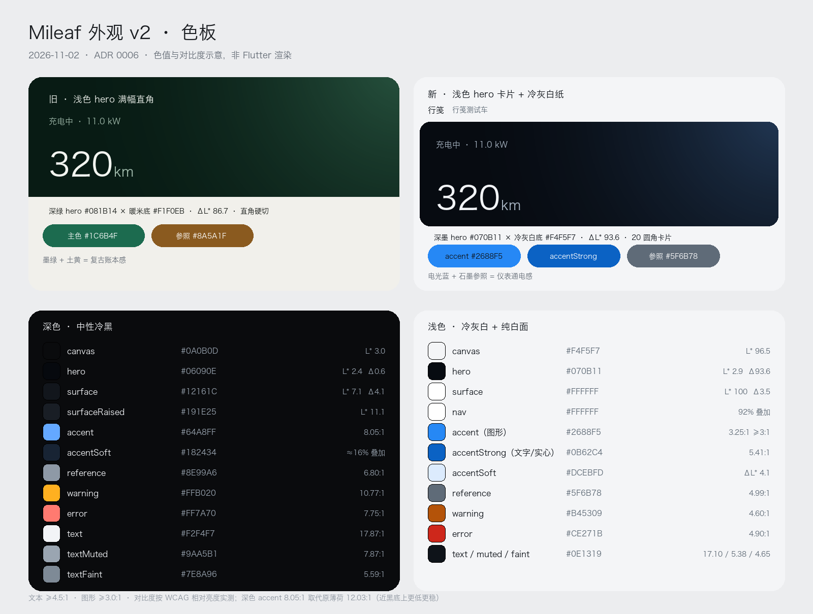

# 外观默认改为「跟随系统」、浅色一体化、强调色改「电光蓝」

- 日期：2026-11-02
- 状态：accepted（2026-11-02 用户确认三条决策；叶标随 accent 变蓝；外观选项改为「跟随系统 / 浅色 / 深色」置顶）
- 关系：修订 [ADR 0003](0003-visual-direction-a.md) 的「深色默认」与「P1 玉绿」两条；继承 A「夜航」的版面范式（每页一个深色锚点、无卡片网格、字号阶梯、圆角与动效 token、03 M 径符号）。不修改数据语义、四 Tab 分工、空/缺失/失败状态和外部待验边界。
- 影响文件：`lib/src/appearance.dart`、`lib/src/appearance_sheet.dart`、`lib/src/design/tokens.dart`、`lib/src/design/semantic.dart`、`lib/src/design/theme.dart`、`lib/src/design/components/hero.dart`、`lib/src/overview_page.dart`、`lib/src/workspace_page.dart`、`test/appearance_shell_test.dart`、`test/design_tokens_test.dart`、`docs/specs/visual-system-a.md`。
- 证据：[色板对照图](../product/appearance-v2-palette.png)（色值与对比度示意，含"旧/新"浅色首屏对照；不是 Flutter 渲染，正式渲染在实施后另行产出）；现有正式渲染 [a-renders](../implementation/a-renders/README.md) 作为"旧"的基线。

## 1. 背景

用户提出三件事：默认外观要改成「跟随系统」；浅色的「一体性」不如深色自然；现在的墨绿主题色沉闷老气，希望按 Apple 的配色哲学年轻化。三条都不是孤立偏好，第二、三条共同指向同一个根因。

### 1.1 代码事实（不是推测）

| 事实 | 出处 |
| --- | --- |
| 默认外观硬编码为深色：`_mode = MileafAppearance.dark` | [appearance.dart:45](../../lib/src/appearance.dart#L45) |
| 「默认深色」写进了设置文案 | [appearance_sheet.dart:70](../../lib/src/appearance_sheet.dart#L70) |
| 「默认深色」写进了注释与测试断言 | [theme.dart:9](../../lib/src/design/theme.dart#L9)、[semantic.dart:39](../../lib/src/design/semantic.dart#L39)、[appearance_shell_test.dart:96](../../test/appearance_shell_test.dart#L96) |
| 「默认深色」写进了验收条款 | [visual-system-a.md:459](../../docs/specs/visual-system-a.md#L459)、[:564](../../docs/specs/visual-system-a.md#L564) |
| 浅色 hero 仍是全幅直角深绿 `#081B14`，页面底是暖米 `#F1F0EB` | [semantic.dart:68-93](../../lib/src/design/semantic.dart#L68-L93)、[hero.dart](../../lib/src/design/components/hero.dart) |
| 浅色强调色 `jade500 #1C6B4F`，深色强调色 `jade300 #74DDA8` | [tokens.dart:10-13](../../lib/src/design/tokens.dart#L10-L13) |
| 参照色是暖砂 `#8A5A1F`（浅）/ `#D8B27C`（深） | [tokens.dart:36-37](../../lib/src/design/tokens.dart#L36-L37) |
| `lib/` 内除 `tokens.dart`/`semantic.dart` 外零硬编码颜色，间距/圆角/字号/时长全部 token 化并有测试守住 | [design_tokens_test.dart](../../test/design_tokens_test.dart) |

最后一条决定了这件事的**成本结构**：换色不需要先做重构，改 2 个文件即可全局生效；但也意味着现有色板是被当作"系统"成立的，替换必须给出同一量级的系统，而不是换几个 hex。

### 1.2 量化：浅色为什么"不一体"

两个模式的分层方式其实是**同一个公式**——「hero 与画布的明度差」和「面与底的明度差」决定材质连续感。差别在于取值：

| 关系 | 深色 | 浅色 | 观感后果 |
| --- | --- | --- | --- |
| hero vs canvas | `#050806` L\*2.0 / `#070908` L\*2.3 → **Δ0.3** | `#081B14` L\*8.0 / `#F1F0EB` L\*94.7 → **Δ86.7** | 深色是"同一块玻璃渐暗"，浅色是"黑纸贴在米纸上" |
| 色温 | 冷绿对冷绿 | **冷绿 hero** 对 **暖米 canvas** | 两个色相在交界处打架，直角切口把冲突放大 |
| surface vs canvas | ΔL\*2.7 | ΔL\*3.2 | 浅色把"面"放在 97.9 与 94.7 之间，人眼在高明度区分辨力最低，读成"一层脏纸" |
| nav vs canvas | nav `#080B09` 更暗 → **后退** | nav `#FAF9F5` 更亮 → **前浮** | 浅色下导航条比页面更白，抢内容 |
| 参照色 | 暖砂是"夜色里的暖点" | 土褐 `#8A5A1F` 是"旧账本" | 与墨绿组成一套复古配色，直接对应"老气" |

### 1.3 "墨绿沉闷"其实是**浅色拿到了墨绿版**

同一条品牌色，深色拿到 `#74DDA8`（高明度薄荷，12.03:1），浅色拿到 `#1C6B4F`（低明度墨绿，5.64:1）。用户看到"沉闷、老气"的，是浅色的那一版——而默认改成跟随系统后，浅色会变成多数用户的第一印象。所以「改默认」和「浅色一体化」「换主题色」必须一起决定，否则等于把一个未打磨的模式设为主入口。

### 1.4 一个被忽略的技术约束

实测候选强调色对 `#F2F2F7` 画布的对比度：鲜亮青 `#0D9488` 3.36、薄荷 `#10B981` 2.27、电光蓝 `#2E90FA` 2.90。**任何"年轻"的颜色都过不了正文 4.5:1**。

Apple 的做法不是把颜色调暗，而是**分层**：`systemTeal`/`systemBlue` 只做填充、图标、图形；文字永远用 label 色或该颜色的深版。Mileaf 现在把 `accent` 同时当"图形色"和"文字色"用（chip 标签、链接、"全部指标"都是 accent），这才是限制色彩活力的真正原因。所以本 ADR 把强调色拆成两层，这不是妥协，是让颜色能变活泼的前提。

## 2. 决策

### D1 默认外观 = 跟随系统

- `AppearanceController._mode` 初值改为 `MileafAppearance.system`；`restore()` 读不到值或值非法时**保留 system**（不是回退 dark）。
- 冷启动不闪色：`main()` 在 `runApp` 前 `await appearance.restore()`，system 由 `MediaQuery.platformBrightnessOf` 同步解析，不引入异步切换（[main.dart:115-132](../../lib/main.dart#L115-L132) 已是这个结构，无需改动）。
- 设置项文案改为「默认跟随系统。切换后立即生效，并保存在本机。」
- 已保存过偏好的用户不受影响；只有从未选择过的设备改变首启外观。
- 地图夜景由 `Theme.of(context).brightness` 决定（[drive_detail_page.dart:473](../../lib/src/drive_detail_page.dart#L473)），system 下自动正确，不需要额外分支。
- 状态栏前景已按解析后的亮度处理（[main.dart:116-121](../../lib/main.dart#L116-L121)），system 下自动正确。

**理由**：深色是设计基线，不该是强加的策略。系统级跟随是 iOS/Android 用户对 2026 年应用的默认预期；"默认深色"实际是把品牌偏好放在用户习惯之前。

### D2 强调色替换为「电光蓝」，并拆成图形 / 文字两层

| 层 | 浅色 | 深色 | 用途 |
| --- | --- | --- | --- |
| `accent`（图形） | `#2688F5` | `#64A8FF` | 图表线/点/面积、进度条、选中 chip 描边、图标、开关轨道、导航指示条 |
| `accentStrong`（文字与实心） | `#0B62C4` | `#64A8FF` | 所有强调色文字（链接、chip 选中标签、导航标签）、实心按钮底 |
| `accentSoft`（底） | `#DCEBFD` | `rgba(100,168,255,.16)` | 选中 chip 底、选择高亮、按压高亮 |
| `accentHero`（hero 上） | `#64A8FF` | `#64A8FF` | 深色 hero 上的图形与光晕 |

浅色只有"图形 / 文字"两种强度，深色合并为一种：`#64A8FF` 在 `#0A0B0D` 上 8.05:1，文字与图形都够用。

**理由**：Apple 的系统蓝是所有"数据 + 工具"类产品的默认语感，也是 Tesla 车主语境里最不违和的科技色；它把"湖畔绿"的沉静换成"仪表通电"的活跃，同时不引入第二个强调色。绿色作为品牌隐喻让位给蓝色作为**交互与数据信号**，这是有代价的取舍（见 §4）。

### D3 中性色系统重做：深色去绿调，浅色去暖调

| 语义 | 深色（旧 → 新） | 浅色（旧 → 新） |
| --- | --- | --- |
| canvas | `#070908` → `#0A0B0D` | `#F1F0EB` → `#F4F5F7` |
| hero | `#050806` → `#06090E` | `#081B14` → `#070B11` |
| surface | `#0E120F` → `#12161C` | `#FAF9F5` → `#FFFFFF` |
| surfaceRaised | `#131814` → `#191E25` | `#FFFFFF` → `#FFFFFF` |
| nav | `#080B09` 90% → `#0A0B0D` 88% | `#FAF9F5` 94% → `#FFFFFF` 92% |

深色的底不再是"绿黑"，而是中性偏冷的墨黑；浅色的底不再是"暖米纸"，而是接近 Apple `#F2F2F7` 的冷灰白，卡片回到纯白。这样：

1. 强调色换成蓝之后，中性底不会残留绿味（否则蓝 + 绿黑 = 脏）；
2. 浅色的"面"第一次真正比"底"亮，卡片靠阶差成立，而不靠 1px 描边；
3. 浅色下导航条比画布亮但被 92% 半透明 + 分隔线约束，回到"后退"。

`lineLight` 从 `#121613` @11% 改为 `#0E1319` @10%，`lineStrongLight` @16%：文字色换了，线的色相也跟过去，避免米色底上一根绿灰线。

### D4 hero 形态由明度差决定：浅色卡片，深色满幅

**规则**：hero 与画布的明度差 > 20 L\* 时，hero 必须是**卡片**（左右 12 外边距、20 圆角、内容仍用 20 页边距）；差 ≤ 20 L\* 时保持满幅。

按现取值，深色 ΔL\*0.6 走满幅，浅色 ΔL\*93.6 走卡片。这条规则把"为什么两个模式不一样"写成了可验证的条件，而不是两个随意样式。

浅色卡片化的连带决定：

- 概览的 `topBar(onHero: true)` 只在深色成立。浅色下品牌行回到纸面，hero 卡片在其下方开始（[workspace_page.dart:189-206](../../lib/src/workspace_page.dart#L189-L206) 传入 topBar，[overview_page.dart:623](../../lib/src/overview_page.dart#L623) 组合进 hero）。
- 卡片 hero 不再承担状态栏背景：`MileafHero` 在卡片形态下不再声明 `SystemUiOverlayStyle.light`，改用页面级（浅色 → 深色图标）。这是当前 [hero.dart:52-56](../../lib/src/design/components/hero.dart#L52-L56) 必须改的一处，否则浅色下状态栏白字看不见。
- 概览 `_topInset()`（[overview_page.dart:628](../../lib/src/overview_page.dart#L628)）在卡片形态下归零。
- 其余 hero 本来就在页面中部（充电费用、统计主图带、充电详情电量弧、停放、专题），卡片化只影响外边距，不动内部排版。

**理由**：浅色下真正的问题不是"深色块存在"，而是"深色块的**边**是直角且与纸面无偿相接"。卡片把 86.7 的明度差变成一个**被设计过的物体**；深色下 ΔL\*0.6 本来就是一块连续的材质，加圆角反而把"夜航玻璃"切成贴纸。

### D5 「参照」去土黄，状态色独立

- `reference`：暖砂 → 石墨（浅 `#5F6B78` / 深 `#8E99A6`），虚线仍保留。"参照/基线"用中性色是数据可视化的通行做法，暖砂的复古账本感是"老气"的第二来源。
- `warning`：浅 `#B45309` / 深 `#FFB020`；`error`：浅 `#CE271B` / 深 `#FF7A70`。两者仍是语义色，只出现在状态与校验，不做装饰、不参与系列配色。
- 数据系列仍只有一条色阶：`accent` → `accent` 50% → `textFaint`（[semantic.dart:130-133](../../lib/src/design/semantic.dart#L130-L133) 的 `seriesPrimary/Secondary/Neutral` 保持不变）。不引入第二强调色。

### D6 品牌符号跟随 accent

`BrandMark` 的颜色来自 `colors.accent`（[top_bar.dart:47-51](../../lib/src/design/components/top_bar.dart#L47-L51)），换成蓝色后「M 径」叶标会变成蓝色。保持这一跟随关系，不新增 `brand` token：一个产品一个强调色，符号变色比"叶标绿 + UI 蓝"的双色更干净。

## 3. 色板与实测对比度

对比度用 WCAG 公式实测（同 [design_tokens_test.dart:15-28](../../test/design_tokens_test.dart#L15-L28) 的算法），L\* 为 CIELAB 明度。

### 3.1 浅色（canvas `#F4F5F7` L\*96.5，surface `#FFFFFF` L\*100）

| 语义 | 值 | 对 canvas | 旧值 | 旧对比度 |
| --- | --- | --- | --- | --- |
| text | `#0E1319` | 17.10 | `#121613` | 16.00 |
| textMuted | `#5A6672` | 5.38 | `#5F6A62` | 4.94 |
| textFaint | `#63707C` | 4.65 | `#646F67` | 4.59 |
| accent（图形） | `#2688F5` | 3.25（图形 ≥3:1 ✓，文字不足 4.5 故另设 accentStrong） | `#1C6B4F` | 5.64 |
| accentStrong（文字/实心） | `#0B62C4` | 5.41 | — | — |
| textOnAccent（在 accentStrong 上） | `#FFFFFF` | 5.90 | — | 6.10 |
| accentSoft | `#DCEBFD` | ΔL\*4.1（底差，非文本） | `#DCEBE2` | ΔL\*3.0 |
| reference | `#5F6B78` | 4.99 | `#8A5A1F` | 5.17 |
| warning | `#B45309` | 4.60 | `#7A4A12` | 6.54 |
| error | `#CE271B` | 4.90 | `#9E4E3D` | 5.10 |
| hero / heroText | `#070B11` / `#F2F4F7` | 17.90 | `#081B14` / `#F2F5F0` | 16.22 |
| heroMuted | `#A7B4C2` | 9.34（hero 上） | `#9FB9AA` | 8.4–9.7 |
| heroFaint | `#8A96A4` | 6.55（hero 上） | `#6F8A7A` | 5.36 |

### 3.2 深色（canvas `#0A0B0D` L\*3.0，hero `#06090E` L\*2.4）

| 语义 | 值 | 对 canvas | 旧值 | 旧对比度 |
| --- | --- | --- | --- | --- |
| text | `#F2F4F7` | 17.87 | `#F2F5F0` | 18.16 |
| textMuted | `#9AA5B1` | 7.87 | `#8C978E` | 6.59 |
| textFaint | `#7E8A96` | 5.59 | `#78837B` | 5.07 |
| accent | `#64A8FF` | 8.05 | `#74DDA8` | 12.03 |
| textOnAccent | `#0A0B0D` | 8.05（accent 上） | `#071009` | 11.64 |
| reference | `#8E99A6` | 6.80 | `#D8B27C` | 10.06 |
| warning | `#FFB020` | 10.77 | `#E0A45E` | 9.17 |
| error | `#FF7A70` | 7.75 | `#D98C7A` | 7.59 |
| surface | `#12161C` | ΔL\*4.1 | `#0E120F` | ΔL\*2.7 |

深色 accent 从 12.03 降到 8.05 是刻意选择：12:1 的薄荷在近黑底上"发光"，蓝在 8:1 更接近 Apple 深色系统色的观感（`#0A84FF` 对 `#000` 为 5.6:1）。仍远超 AA 与图形 3:1。

### 3.3 明度阶自检

| 对 | 目标 | 实测 |
| --- | --- | --- |
| 浅色 canvas → surface | ≥3 L\*（要读得出"面"） | 3.5 |
| 浅色 canvas → hero | ≥80 L\*（深色锚点必须成立） | 93.6 |
| 深色 canvas → surface | ≥3 L\* | 4.1 |
| 深色 canvas → hero | ≤2 L\*（连续材质） | 0.6 |

## 4. 被否的替代方案

| 方案 | 否掉的理由 |
| --- | --- |
| 保留墨绿，只把 `jade500` 提亮到 `#0F766E` 一档 | 色相仍是"文具绿/环保绿"，实测 4.80:1 够读但饱和度低，无法达成"年轻化"；且解决不了浅色一体化与参照色土黄两个独立问题 |
| 青主 + 蓝辅（双色，含 D 方案） | 两个强调色会让"选中/数据/连线"三处信号互相稀释；Apple 哲学是**一个** tint + 中性系列 |
| 浅色取消深色 hero（改为白底大数字） | 会丢掉 A「夜航」"每页一个深色锚点"的识别度，等于浅色换一套设计；用户明确选择保留锚点 |
| 保留暖米纸，只把绿强调色转暖 | 蓝 + 暖米是补色关系，会显脏；且暖米纸本身是"复古"的主要来源 |
| 深色也做卡片 hero | ΔL\*0.6 时圆角会切出一条本不存在的边，破坏"夜航玻璃"的连续感 |
| 直接把 `#2E90FA` 当唯一强调色 | 对白卡 3.24:1，正文链接与 chip 标签掉出 AA；这正是必须拆 graphic/text 两层的原因 |

## 5. 后果与风险

**必须同步改的地方**（Spec 会逐条落成验收项）：

1. `appearance.dart` 默认值 + `restore()` 回退语义；`appearance_shell_test.dart` 三条断言（默认深色 → 默认跟随系统、未知值回退、冷启动）。
2. `appearance_sheet.dart` 文案；选项顺序改为「跟随系统 / 浅色 / 深色」，默认项在首位。
3. `tokens.dart` 全量色板；`semantic.dart` 两张构造 + 新增 `accentStrong`；`theme.dart` 里 `ColorScheme.primary`、`chipTheme`、`textButtonTheme` 等把文字类的 `accent` 换成 `accentStrong`，图形类保持 `accent`。
4. `hero.dart` 增加卡片形态与卡片下的系统栏处理；`overview_page.dart` 的 `onHero` 与 `_topInset()` 跟随形态。
5. `design_tokens_test.dart` 的对比度表、`浅色 hero` 断言、`light.accent == MileafPalette.jade500` 一类硬断言。
6. `visual-system-a.md` §2.4 对比度表、§9.8 默认外观、§14 验收清单第 1 条。

**风险与已知代价**：

- **深色观感会变**：绿黑 → 中性冷黑，蓝色光晕替代绿色光晕。这是"换主题色"的必然连带，但用户可能只预期浅色变。需要浅/深各一轮前后对比渲染再决定是否微调。
- **绿色品牌识别消失**：叶标变蓝，`#74DDA8` 不再出现在任何界面。这是 §4 里明确接受过的取舍。
- **浅色变成主入口**：默认跟随系统后，浅色是多数用户的首次观感，浅色的打磨质量直接决定"消费级"判断。反过来说，这也让本次的浅色改造收益最大化。
- **卡片 hero 是一次结构性改动**，涉及 7 处 hero 调用与概览的头部归属，回归面比换色大。7 处已全部定位：[overview_page.dart:623/702/752](../../lib/src/overview_page.dart#L623)、[charging_page.dart:870](../../lib/src/charging_page.dart#L870)、[charging_detail.dart:397](../../lib/src/charging_detail.dart#L397)、[statistics_insights_page.dart:783](../../lib/src/statistics_insights_page.dart#L783)、[statistics_parking_page.dart:357](../../lib/src/statistics_parking_page.dart#L357)。

**不做什么**：不改版面结构、不改字号阶梯与字重、不改圆角体系（20/12/10/4）、不改动效时长、不改图标网格、不新增图表类型、不动地图 provider、不改任何数据语义与接口。

## 6. 验证方式

- `design_tokens_test.dart` 按 §3 的新数值重算，任何一项低于 AA（文本 4.5）/ 图形 3.0 / 明度阶目标即失败。
- `test/appearance_shell_test.dart` 覆盖：首启 system、system 下浅色/深色主题解析、已存偏好优先于系统。
- 正式 Flutter 渲染四主 Tab + 两类详情 × 浅/深 × 100/200%，与现有 [a-renders](../implementation/a-renders/README.md) 同机位前后对比。
- 真机、真实站点/地图、性能与双端隔离构建仍是独立外部 gate，不因本 ADR 关闭。

## 7. 已裁决的小项（2026-11-02）

1. **叶标随 accent 变蓝**（D6）：接受"一个强调色"，不新增 `brand` token。
2. **外观选项顺序**改为「跟随系统 / 浅色 / 深色」（D1），默认项置顶。

下游产物：Spec 见 [外观 v2 设计规格](../specs/appearance-v2.md)；Ticket 在 Spec 确认后产出。
