# A「夜航」概览样张（VA04 交样）

- 日期：2026-11-01
- 分支：`codex/mileaf-v1`（本地提交，未推送）
- 范围：VA01–VA04 的概览首个视觉切片。VA05–VA14 已完成，完整图册见 `../gallery/`。
- 生成入口：`test/a_overview_render_test.dart`（opt-in，`MILEAF_RENDER_OUTPUT` 未设置时跳过）
- 生成条件：360×800 逻辑像素、pixelRatio 2（PNG 720×1600）、浅/深 × 100/200% × normal/empty/missing = 12 张。
- 字体：随包 Inter 400/500/600 + 渲染机 CJK fallback（Arial Unicode）；真机应走 PingFang SC / Noto Sans CJK。
- 数据：`test/support/c_fixture.dart` 的合成 fixture，不是真实站点；normal 的参照线在样张客户端里缩放到 0.92，仅用于让砂色虚线可辨。
- 来源指纹：
  - 12 张 PNG：`sha256(find . -name '*.png' | sort | xargs shasum -a 256 | shasum -a 256)` = `f6db82766bc61803c2afee2bd9ec2c6d4e79a44fac88ebab50a61ec5cd6917b5`
  - 页面/组件/格式化源码 + 渲染入口：`e8cd872c6d62fac7d95df919b18425e32c6f47f8c9a966c6f3bb11ee4780f678`

## 矩阵

| 场景 | 深色 100% | 深色 200% | 浅色 100% | 浅色 200% |
| --- | --- | --- | --- | --- |
| normal | 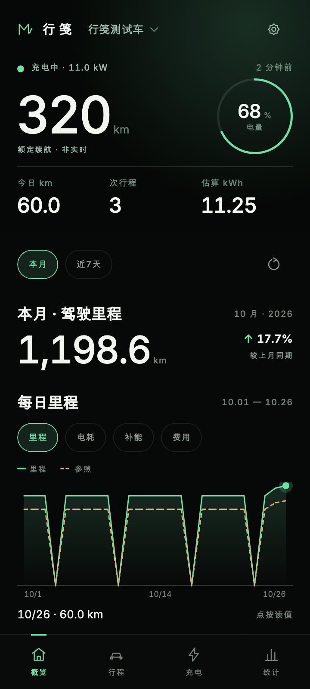 | 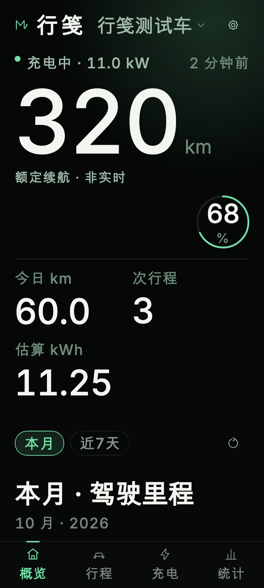 | 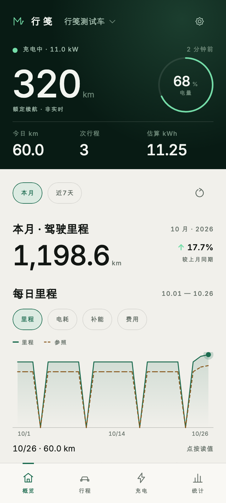 | 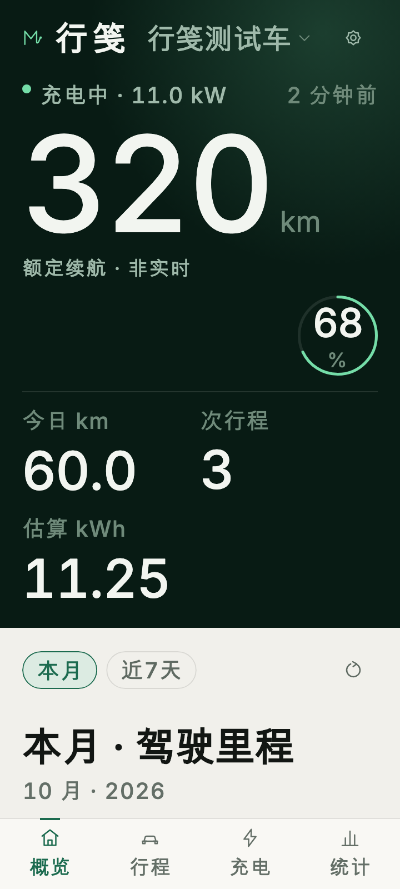 |
| empty | 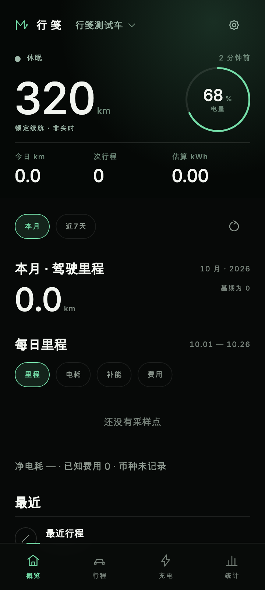 | 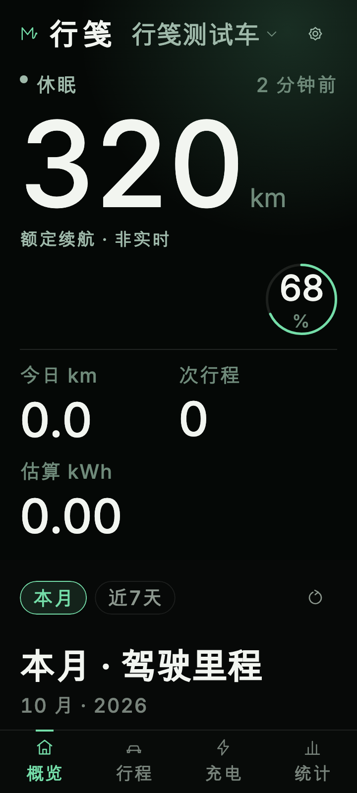 | 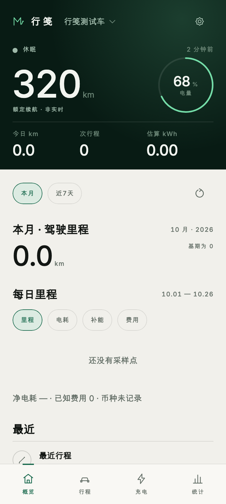 | 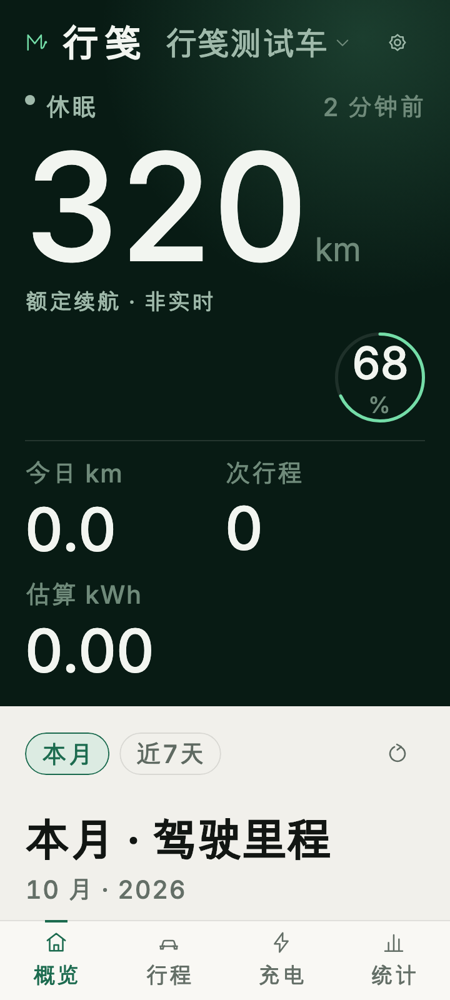 |
| missing | 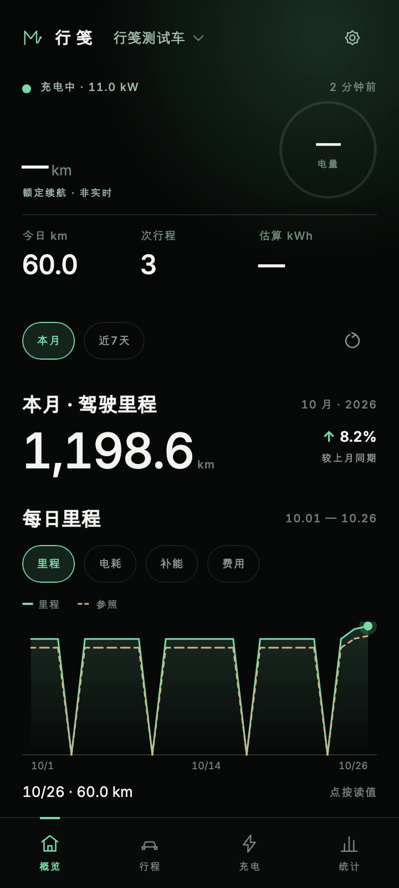 | 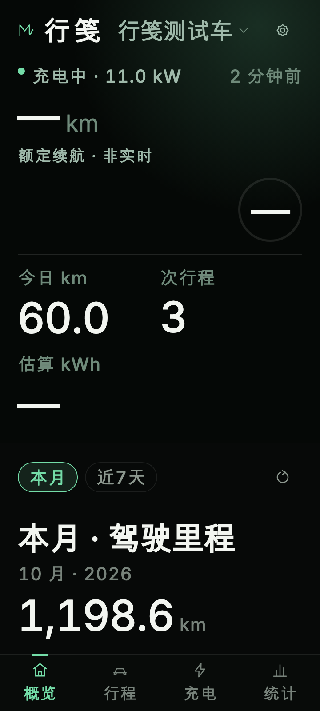 | 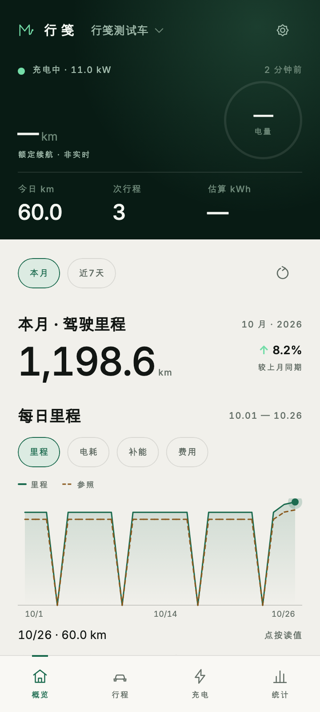 | 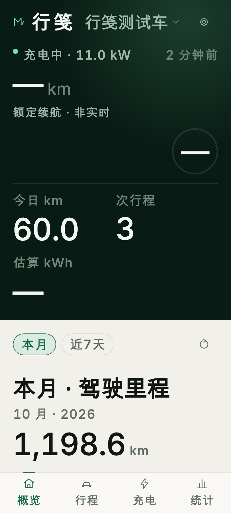 |

### 这 12 张各自证明什么

- **normal**：深色车况 hero（320 km / 68% / 今日 60.0 · 3 · 11.25）→ 本月 1,198.6 km + 同期变化 → 每日里程主图（实线本期、砂色虚线参照、当前点 halo、点按读值）→ 辅助读数。浅色页仍保留深色 hero；200% 下 hero 单列、今日 2 列、图表隐藏 Y 轴并保留读数。
- **empty**：真实 0 保留（0.0 / 0 / 0.00），主图显示“还没有采样点”，不画全零折线；最近记录显示空态文案。
- **missing**：续航/电量/今日能量缺失显示 `—`，不补 0；费用字段缺失显示 `—`，不补 0、不默认 CNY。
- **时间**：状态行显示“2 分钟前”，不再出现“N 万分钟前”；≥24h 会显示日期。
- **费用**：有金额但无币种时“已知费用 186.4 · 币种未记录”，不括号换行、不默认 CNY；有币种时显示 `¥186.4`。

## 与原型/既有实现的差异

1. **保留了“本月/近7天 + 单一刷新”区间行**：VA02/VA04 要求页面只保留一个刷新入口且切换区间能力不丢；它占用约 60dp，因此 360×800、100% 下“最近”区从首屏下缘开始，需要轻微滚动。主图与读数完整落在首屏内。
2. **导航 active 标记在顶部**（Spec §7.7 / ADR §6.1）；方向原型把标记画在图标下方。这里按已接受的 Spec 实施。
3. **200% 电量弧**：中心 `68` 保留，`%` 下移一行、`电量` 标签省略，以保证主数与单位同时可见；弧径 72。
4. **缺失主数**：`—` 按 `metric-md`（24）绘制，避免 display 尺寸下变成一条长白条；仍使用 U+2014，不补 0。
5. **概览不再有 C 的“四个问题”卡片**：改为“继续”三行（节奏/能耗/长期）；充电统计入口收在“数据说明与更多”里的“充电统计”，主 Tab 仍可直接进入充电。
6. **C 的薄荷/沙色 tile、18px 卡片与 `stretch` 等高布局已移除**；内容区无卡片，只有 1px 细线与留白。

## 本轮验证

- `tool/flutterw analyze --no-pub`：通过。
- `tool/flutterw test --no-pub`：351 通过、22 跳过（跳过项为 opt-in 渲染/真机类入口）。
- 本目录 12 张全部由正式 Flutter 页面渲染；`a_overview_test.dart` 覆盖弧不裁切、唯一深色锚点、无卡片、本月块不留空、200% 单列/两列、浅色 hero 对比度。
- `overview_a_regression_test.dart` 覆盖时间人性化、币种缺失/已知、空态不画全零、部分缺失 `—`、200% 浅色无溢出。

## 仍未验证（外部 gate，不因样张通过而关闭）

- 真机（Android/iOS）字体回退、状态栏/安全区、TalkBack/VoiceOver。
- 真实站点数据、地图底图/CRS/许可、性能与双端隔离构建。
- 360×800 之外的真实设备宽度与系统 reduce motion 的手工体验。
- 启动图标/商店素材（不在本 Spec 范围）。

## 复现

```sh
tool/flutterw test --no-pub \
  --dart-define=MILEAF_RENDER_OUTPUT=docs/implementation/a-renders/overview \
  --dart-define=MILEAF_RENDER_FONT="/System/Library/Fonts/Supplemental/Arial Unicode.ttf" \
  test/a_overview_render_test.dart
```
