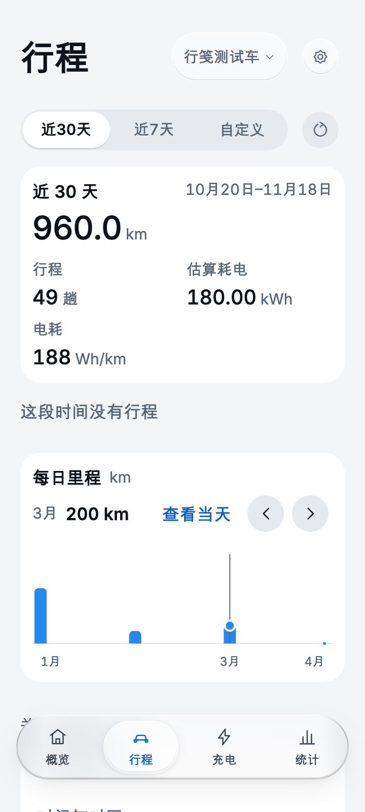
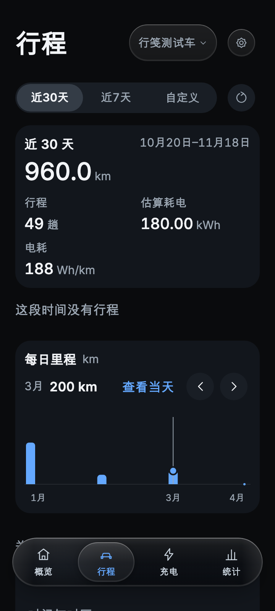
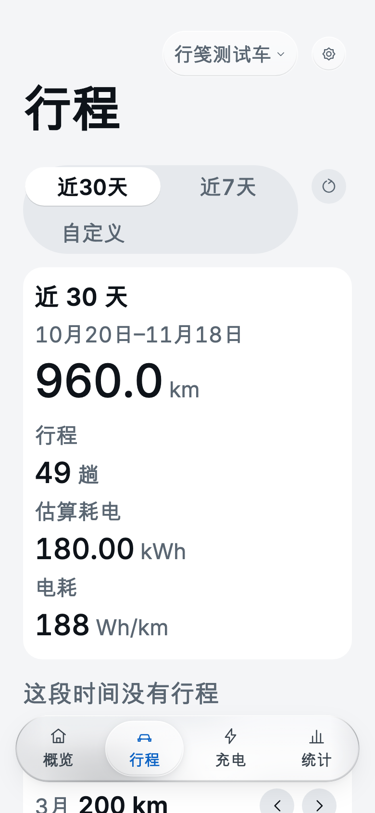
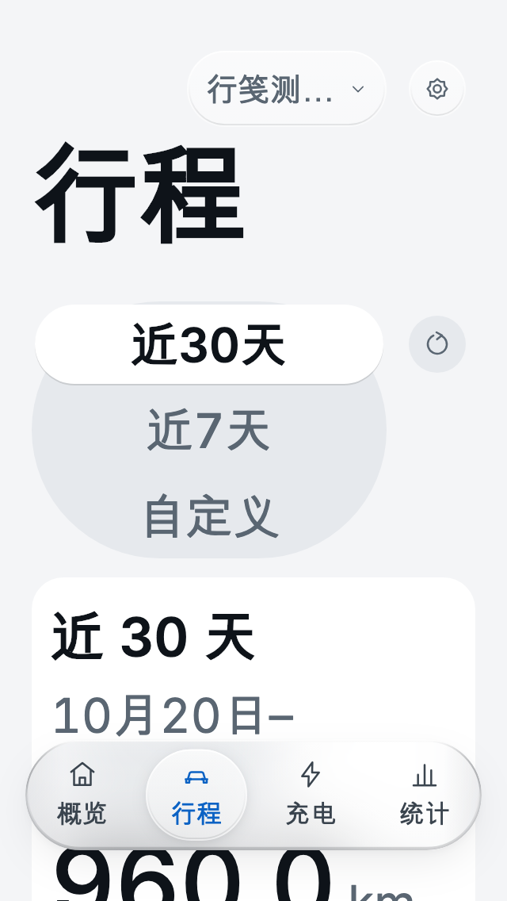

# 行程焦点卡卡头重排（期间名 + 区间）实施记录

2026-11-18 在 `main` 工作区完成（未推送）。用户以截屏红框指出：360 宽设备上「近 30 天」右侧的区间 `10月20日–11月18日` 折成两行，末尾的「日」孤零零挂在第二行。条款依据 [Apple 焕新规格](../specs/apple-polish.md) R21 第 4 条（同一信息每个模块只出现一次：区间、单位、期间名不在标题、控件和读数里重复）、R21 第 6 条（焦点值周围至少留 12）、R24（卡内「标题行 → 内容」12）；文案依据 [Apple 焕新文案](../specs/apple-polish-copy.md) DF3（日期区间格式、连接号 U+2013、读屏读作「至」）。配色、字号、圆角、动效一律沿用既有 token，未新增任何 token。

## 1 问题

卡头是一个 `Row`：期间名 `Expanded`、区间 `Flexible`。两个弹性子项按 flex 1 均分剩余宽度，于是**区间最多只能用到卡片内容宽的一半**：

| 卡片内容宽 | 区间可用（一半） | 真实区间宽（100%） | 结果 |
| --- | --- | --- | --- |
| 296（360 宽设备） | 144 | 13 字 ≈ 141–157（随字体不同） | 临界：只要多一个字或字体略宽就折行 |
| 246（320 宽设备） | 119 | 同上 | 100% 起就折行 |

折行后 CJK 按字断行，末尾的「日」成为孤字；红框圈住的正是这一行。150% 以上虽然走「大字改两行」分支，但那是**按字号阈值**（`TextScaler ≥ 1.5`）近似、**与实际宽度无关**：430 宽 150% 明明放得下也照样拆成两行，360 宽 100% 放不下却还挤在一行。

## 2 设计

排法改由**实际宽度**决定，不再用字号阈值近似：

1. **一行放得下**：期间名靠左、区间靠右，与卡片内容右沿同线（与页面里的 `SectionHeader` 同构）。
2. **放不下**：区间整段落到期间名下一行，行距 `s4`、左对齐——每个日期都是完整的一段。
3. **整段区间也放不下一行**（320 宽 200%）：只在 DF3 的连接号后断行（`10月20日–` / `11月18日`），**不拆日期**。
4. **读屏**：区间按 DF3 读法朗读（连接号读作「至」，`copy.formatRangeReading`），断成两行时也只读一段；期间名标为 `header`，与 `SectionHeader` 一致。

组件：`lib/src/design/components/period_header.dart` 的 `MileafPeriodHeader(label, range)`，`range` 是 `PeriodRange` 记录 `(text, reading)`——「看得见」的 DF3 写法与「读得出」的读法一起传，不留给组件猜。外层 `Wrap(spaceBetween)` 负责 1/2 两种排法（`runSpacing: s4` 与原来的大字分支同值），内层用一个 `TextPainter` 只判断「整段区间能否一行放下」，据此决定是否按连接号分两段 `Text`；连接号常量由 `copy/dates.dart` 的 `rangeSeparator` 单一提供。

行程页 `_summary` 与概览页 `_focusCard` 原来各自复制了同一段 `if (large) Column(…) else Row(…)`，现统一改为同一个组件；两页的 `large` 仍只用于三格读值的单列/网格，不再兼职卡头排版。区间与读法都由同一个窗位算一次（`_periodRange` / `_rangeParts` 返回记录）。

## 3 证据

渲染入口（opt-in）`test/period_header_render_test.dart`，夹具 `test/fixtures/driving-stats.json`，站点日历 `Asia/Shanghai`，参照时刻 `2026-11-18T12:00Z`（近 30 天 = 10月20日–11月18日，13 字）；字体 `/System/Library/Fonts/Supplemental/Arial Unicode.ttf`（CJK 兜底）。机位 DPR 1，截图按 `pixelRatio: 2` 导出（PNG 为逻辑尺寸的 2 倍）。

```
./tool/flutterw test --no-pub test/period_header_render_test.dart \
  --dart-define=MILEAF_RENDER_OUTPUT=docs/implementation/period-header-renders \
  '--dart-define=MILEAF_RENDER_FONT=/System/Library/Fonts/Supplemental/Arial Unicode.ttf'
```

| 图 | 机位 | 结论 |
| --- | --- | --- |
|  | 360×800 100% 浅色 | 用户报告机位：期间名与区间同一行，区间右端与卡片内容右沿同线 |
|  | 360×800 100% 深色 | 同上，深色同构 |
|  | 390×844 150% 浅色 | 区间整段落一行，左对齐、完整 |
|  | 320×568 200% 浅色 | 整段也放不下：只在连接号后断行，日期不被拆开 |

## 4 验证

| 命令 | 结果 |
| --- | --- |
| `./tool/flutterw analyze lib/src/design/components/period_header.dart lib/src/copy/dates.dart lib/src/drives_page.dart lib/src/overview_page.dart test/drives_test.dart test/design_components_test.dart test/period_header_render_test.dart` | 无诊断 |
| `./tool/flutterw test --no-pub test/design_components_test.dart --name MileafPeriodHeader` | 4 通过（一行右对齐 + 读作「至」、落到下一行、连接号后断行、无区间不占位） |
| `./tool/flutterw test --no-pub test/drives_test.dart --name '焦点卡区间'` | 2 通过（360/100 一行、320/200 连接号后断行）；把 `drives_page.dart` 回退到改动前（`git show HEAD:lib/src/drives_page.dart`）时 360 用例 **失败**（区间高 42 = 两行），红→绿成立 |
| `./tool/flutterw test --no-pub test/drives_test.dart test/overview_test.dart test/design_components_test.dart test/apple_polish_ap07_test.dart test/apple_polish_ap09_test.dart test/apple_polish_copy_test.dart test/apple_polish_copy_guard_test.dart test/period_header_render_test.dart` | 163 通过 / 1 跳过（opt-in 渲染入口未传开关）/ 0 失败（含 AP07 的 360×800 首屏预算用例与文案守卫） |
| `./tool/flutterw test --no-pub`（全量） | 1076 通过 / 51 跳过 / 0 失败 |

回归用例用 11 字区间（`9月10日–10月9日`）：测试字体每字 1em，11 字 = 165 > 旧布局的一半 144，且 102 + 8 + 165 = 275 ≤ 296 放得下整行——旧布局折行、新布局一行，与人眼在真实字体下看到的 13 字区间同一机制。真实字体下的 13 字机位由上面的渲染图证。

## 5 遗留与边界

- **卡头 → 焦点值的间距仍是 `s4`**（行程 `drives_page.dart` 与概览 `overview_page.dart` 的焦点卡）。R24 要求「卡内：标题行 → 内容 12」，R21 第 6 条要求「焦点值周围至少留 12」，按字面应为 `s12`。现值是 AP09/AP07 为 360×800 首屏预算（第二条记录至少 24 可见）压出来的，本次未改：改它会把这 8 加回去、直接吃首屏预算，属版面归属问题，留给视觉裁定，不在本切片擅动。
- **跨年长区间**（DF3「跨年两端都带年」，如 `2025年12月28日–2026年1月3日`）：320 宽 200% 时连接号前半段本身超过一行，`Text` 仍按字折行，孤字可能回归。这是本组件能给出的最窄形态（不缩字号）；如需彻底消除，只能另立「大字下改用紧凑区间」的格式规则，须先改 DF3。
- **加载中的卡头**：统计未到时 `range` 为空，卡头只有期间名，数据到达后区间出现，可能让卡头从一行变两行（高度 +4/一行）。改动前同样如此（区间是响应到达后才有的），本次未做占位。
- **读屏读法此前从未接上**：`copy.formatRangeReading` 长期只有测试在调用；本次由组件在卡头接上。其他位置（详情页「与近 30 天相比」等）仍在用 DF3 的视觉写法朗读，未在本切片统一。
- 概览页在同一组件下，130–149% 字号时也会从「挤在一行」改成「区间落到下一行」——这是同一缺陷的同一修法（用户只报了行程页，但两页共用卡头）。
- **未提交**：工作区同时有 Apple 焕新、底栏与充电行等其它在途改动（`map_privacy_page.dart`、`tokens.dart`、`charging_page.dart` 等），其中 `design_components_test.dart`、`components.dart` 与本切片重叠，按路径暂存会把他人的改动一起带走，故本次只留工作区。
- 真机字体（PingFang 与 Arial Unicode 的数字宽度不同）、读屏与性能仍归 #16/#17 的外部 gate，本次不关闭。
