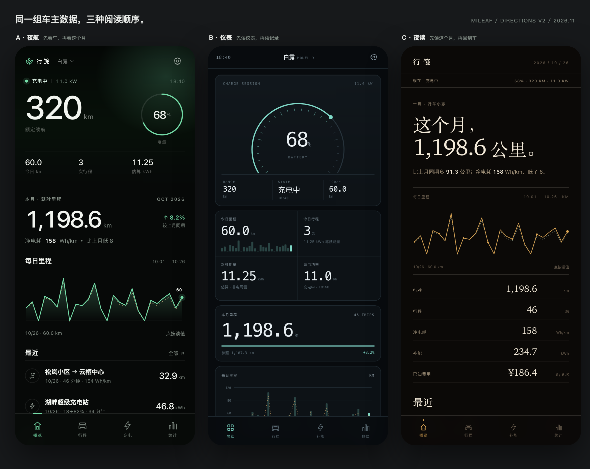

# 行笺视觉方向评审 v2：三套阅读顺序

日期：2026-11-01
状态：**2026-11-01 用户已选择 A「夜航」**；B/C 保留为评审历史。未修改 Flutter 页面、Spec、Ticket 或接口。

> 后续细化：强调色 **P1 玉绿**、符号 **03 M 径**；设计决定见 [ADR 0003](../adr/0003-visual-direction-a.md)。本文的方向对比与图册作为选择依据保留。
范围：在 C「数据拼贴」已通过 C10 之后，按“深色默认、浅色保留、允许重定品牌色、允许内置字体、概览首屏再减一层”的新约束，重新做一次方向评审。
证据：本文 + [评审图册](../prototypes/directions-v2/renders/index.html) + [并排图](../prototypes/directions-v2/renders/compare-dark.png)。

## 先说结论

推荐 **A「夜航」**。它在“5 秒确认车况、30 秒读懂这个月、5 分钟下钻”三个时间尺度上都没有明显短板，深色是设计出来的而不是补出来的，也不依赖中文字体资产。

**C「夜读」** 的品牌气质最强，如果「行笺」首先是一个有性格的品牌、其次才是一辆车的数据工具，C 值得选；代价是中文衬线字体、首屏车况降级和更高的实现成本。

**B「仪表」** 的精度感最强，但离 Grafana 的运维仪表语言最近，不建议作为主结构。

三套方向不是换色稿：

| 方向 | 一句话 | 第一视觉 | 阅读顺序 |
| --- | --- | --- | --- |
| **A 夜航** | 一块夜里的仪表玻璃，其余退成纸面 | 深色车况主屏 + 320 km | 车现在怎样 → 这个月 → 趋势 → 最近 → 专题 |
| **B 仪表** | 像读一块精密仪表，每个数字都有刻度 | 270° 电量仪表 + 等宽数字 | 仪表 → 读数格 → 里程表 → 图 → 记录 |
| **C 夜读** | 把一个月写成一段夜读：大字、留白、纸感 | 衬线大标题 + 1,198.6 公里 | 这个月 → 图版 → 账簿 → 最近 |

## 为什么需要重开

C10 已通过，说明 C 的阅读顺序和“一个主导 tile”的方向成立。但把当前正式渲染放大看，问题不在方向，在**工艺与系统**：

1. **深色是补出来的。** `lib/src/visual_theme.dart`（随 C 方向退役已删除，见提交 `725ceda` 前的历史）用 `ColorScheme.fromSeed` 生成深色；`lib/src/collage.dart`（同上）的深色 mint `#1E3B2C`、sand `#3B3120` 发浊，hero `#06140F` 与页面底 `#09140F` 几乎同色，深色下车况主屏失去锚点。浅色是事实上的主设计。（深色概览图随 2026-11-02 图册归档删除，见 [render-archive.md](../implementation/render-archive.md)。）

2. **没有 token 体系。** 颜色和 18px 卡片圆角集中在主题文件，但页面里散着 9–48px 字号、8–22px 圆角、重复硬编码色（`#8AD6AF` 7 次、`#EEF7EF` 6 次）。`collage.dart`（已删除）只抽象了 4 种表面，没有间距、阴影、动效、图表 token。结果是“每页各自精致”，不是“一套系统”。

3. **会被截图放大的硬伤。** [overview_page.dart:717](../../lib/src/overview_page.dart#L717) 直接输出“326880 分钟前”；`_monthBento()` 的 `stretch: true` 让本月 tile 下方出现整块空白（[overview_page.dart:1456](../../lib/src/overview_page.dart#L1456)、`collage.dart:63`（已删除））；“72（币种未知）”被迫换行；AppBar 的“刷新车辆”与页内“刷新概览”形成两个刷新入口（[workspace_page.dart:218](../../lib/src/workspace_page.dart#L218)、[overview_page.dart:1444](../../lib/src/overview_page.dart#L1444)）。

4. **数字只做了半套。** `fontFeatures: tabularFigures` 只在 hero、本月主数等少数位置生效；图表读数、记录行、辅助数字未统一；没有数字字体策略。

C 仍然有扎实的部分：四 Tab、地图/电池弧、图表点读、空/缺失/失败语义、68 张实际渲染图册。这次不是推翻 C 的成果，而是决定**下一版用哪种视觉语言承载它**。

## A · 夜航

**概念**：深色只出现在每页一个位置——车况主屏。其余内容退成近黑纸面，用细线、留白和字号分层，不再用彩色卡片填满页面。

**结构**
- 概览：全幅深色车况（320 km、68% 电池弧、充电中/今日摘要）→ 本月 1,198.6 km + 同期变化 → 每日里程主图 → 最近行程/充电 → 节奏/能耗/长期细行入口 → 数据说明。
- 统计：结论大数 + 深色主图带 → 一条洞察 → 2×2 章节（节奏/能耗/补能/长期）。
- 行程：期间主数 → 紧凑节奏图 → 最近的路列表；详情以满幅地图开场。
- 充电：¥186.4 主屏 + 8/9 覆盖条 → 三个辅助读数 → 每日补能 stem → 构成 → 地点账目。

**视觉规则**
- 颜色：近黑绿 `#070908`、hero `#050806`、玉绿 `#74DDA8`、暖砂 `#D8B27C`；浅色暖石 `#F1F0EB` + 深湖绿 `#1C6B4F`。深色下 hero 与页面仍有明度差。
- 字体：Inter（或系统 SF）+ 中文系统黑体；数字统一 tabular；66/47/22/13/9 五级。
- 表面：hero 无圆角、无卡片；内容区无卡片；只有 chip、输入、底部 sheet 有 10–20px 圆角。
- 图表：时间趋势用线/面积；离散补能用 stem（细竖线），不再用连续折线跨过 0；当前点实心 + 光晕；参照虚线用暖砂；单位、范围、读值同时出现。

**优点**：5 秒落点最明确；深色/浅色都能保持“一个深色锚点”；实现成本最低；不需要中文字体资产；最接近 Tesla App / Apple Health 的消费级语感。
**风险**：深色块重复使用会重新变重；没有卡片后，分组完全依赖留白与细线，间距必须严格 token 化。

## B · 仪表

**概念**：把车况做成一块精密仪表。所有数字有刻度、单位和位置；版式像一张被设计过的工程读数表，而不是运维看板。

**结构**
- 概览：顶部状态轨 → 270° 电量仪表 → 3 个仪表读数 → 2×2 读数格 → 本月“里程表” + 参照刻度 → 每日里程柱图 → 最近记录表。
- 统计：结论面板 → 带坐标轴/网格的主图 → 2×2 读数格 → 全部指标。
- 行程：期间主数 → 节奏柱带 → 记录表（时间/路线/分钟/里程四列）；详情地图带比例尺/指北针。
- 充电：费用面板 + 覆盖条 → 三读数 → 每日补能柱图 → AC/DC 分段条 → 地点表。

**视觉规则**
- 颜色：蓝黑 `#080B0E`、冷薄荷 `#7FD9C8`、钢灰、暖砂参照；浅色冷纸 `#EDF1F0` + 深青 `#176B5E`。
- 字体：正文系统黑体；数字与微标签用等宽（IBM Plex Mono / SF Mono）；7–9px 大写字母间距标签；43/25/8 三级。
- 表面：12px 面板 + 1px 描边 + 顶部内高光；不用阴影；不用彩色填充。
- 图表：柱 + 坐标轴 + 网格；速度过程用线；所有图有单位、刻度、当前值。

**优点**：数据密度最高；仪表感、技术感最强；细节最“经得起放大”；适合喜欢读数的车主。
**风险**：7–9px 微标签在 200% 字号下必须重排；等宽数字 + 大写标签容易滑向 Grafana/赛车仪表；情绪温度最低。

## C · 夜读

**概念**：把一个月写成一段夜读。暖墨底、衬线大字、细线账簿、少量琥珀；数据像被安静地记录，而不是被监控。

**结构**
- 概览：报头 + 一行“现在” → 衬线大标题“这个月，1,198.6 公里。” → 每日里程图版 → 行驶/行程/净电耗/补能/费用账簿 → 最近两条。
- 统计：结论式标题“比上月多跑了 91.3 公里。” → 图版 → 01–04 编号章节。
- 行程：“最近的路”标题 + 期间主数 → 节奏条带 → 按日期排列的行程条目。
- 充电：“这个月，补能花了 ¥186.4。” → 图版 → 账簿 → 构成 → 地点。

**视觉规则**
- 颜色：暖墨 `#0B0907`、琥珀 `#D8A353`、鼠尾草参照 `#8E9C86`；浅色羊皮纸 `#F2EADB` + 焦茶 `#9A5A24`。
- 字体：标题与数字用衬线（Charter / Iowan / Songti SC），正文与元数据用系统黑体；37/47/19 三级；账簿数字右对齐。
- 表面：无卡片；图版用上下细线框住；条目用细线分隔；只有地图导航按钮是圆形浮层。
- 图表：细琥珀线 + 点；离散补能用 stem + 点；参照用鼠尾草虚线；没有坐标轴，只有首末读值。

**优点**：品牌辨识度最高；最像「行笺」这个名字；浅色尤其好看；排版自信。
**风险**：中文衬线的跨端可得性——iOS 有 Songti SC，Android 不保证 Noto Serif CJK；内置中文衬线字体体积大。首屏把“现在”压成一行 8px 状态条，5 秒确认车况弱于 A/B。200% 字号下衬线大标题和图版需要重新断行。

## 对比

评分 1–5，仅用于方向取舍，不是验收结论。

| 维度 | A 夜航 | B 仪表 | C 夜读 |
| --- | --- | --- | --- |
| 5 秒确认车况 | **5** | 4 | 3 |
| 30 秒读懂本月 | **5** | 4 | 5 |
| 5 分钟下钻 | 4 | **5** | 4 |
| 品牌辨识度 | 4 | 3 | **5** |
| 深色完成度 | **5** | **5** | 4 |
| 浅色等价 | **5** | 4 | 4 |
| 大字号/200% 可读性 | **5** | 3 | 4 |
| 与 Grafana 的距离 | **5** | 2 | 4 |
| 实现成本（5 最低） | **4** | 3 | 2 |
| 数据密度 | 3 | **5** | 2 |

## 推荐

**选 A 作为主结构。** 理由不是“保守”，而是：

1. 它把“车现在怎样”放回第一视觉，直接回应日常打开 App 的最高频问题；C 把这个信息压成一行状态条，B 要读仪表才能得到。
2. 深色 hero 与浅色纸面形成“一页一次满幅—内缩”的节奏，符合“深色为主基调、浅色保留”的新约束，而且不需要彩色 tile 堆叠。
3. 没有中文字体依赖；Inter + 系统中文 + tabular 数字即可达到消费级观感，工程风险最低。
4. 它吸收 C 的排版自信（更大的结论、更少卡片）和 B 的数字纪律（tabular、微标签、图表读数），但不保留 C 的彩色 tile 与 B 的仪表刻度。

如果选 A，ADR 会锁定：深色默认、浅色等价、三层 token（primitive/semantic/component）、五级字号、4/8/12/20 圆角、细线与唯一阴影、图表语法、状态矩阵、200% 重排规则。品牌绿会在 A 的玉绿与现有湖畔绿之间重新调一档，不直接沿用当前深色 mint。

**如果品牌优先于工具感，选 C。** 但 ADR 必须先回答三个问题：中文衬线用系统回退还是内置字体；首屏是否把“现在”提升为独立状态块；200% 下衬线标题如何断行。C 的浅色版本是三套里最有“行笺”气质的。

**不建议 B 作为主结构。** 它可以作为 A 的图表/数字细节参考，但整套 B 的微标签、等宽数字和网格会把产品拉回“改装仪表盘”。

## 评审边界

- 原型：`docs/prototypes/directions-v2/`，固定合成数据，360×800，Chrome headless 实际渲染。
- 覆盖：概览、统计、行程、行程详情、充电五屏 × 三方向深色；概览/统计 × 三方向浅色。
- 未做：真实 Flutter 渲染、真机、真实站点、地图底图/坐标、性能、200% 全矩阵（原型只验证了方向，不是验收）。
- 未改：`lib/`、`test/`、Spec、Ticket、依赖、后端。

## 需要你确认

1. 选 **A 夜航**（推荐）、**B 仪表**、**C 夜读**，还是“A 为主，吸收 C 的某一部分”？
2. 如果选 A：品牌绿保留现在的玉绿方向，还是更冷/更暖一档？
3. 如果选 C：中文衬线接受“系统衬线 + 无衬线回退”，还是必须内置中文衬线字体（包体显著增加）？
4. 有没有必须从当前 C 保留的元素（例如 mint 本月 tile、四章节卡、数据说明层）？

确认后我再写 ADR；ADR 确认后写 Spec；Spec 确认后拆 Ticket。方向确认前不改正式页面。
