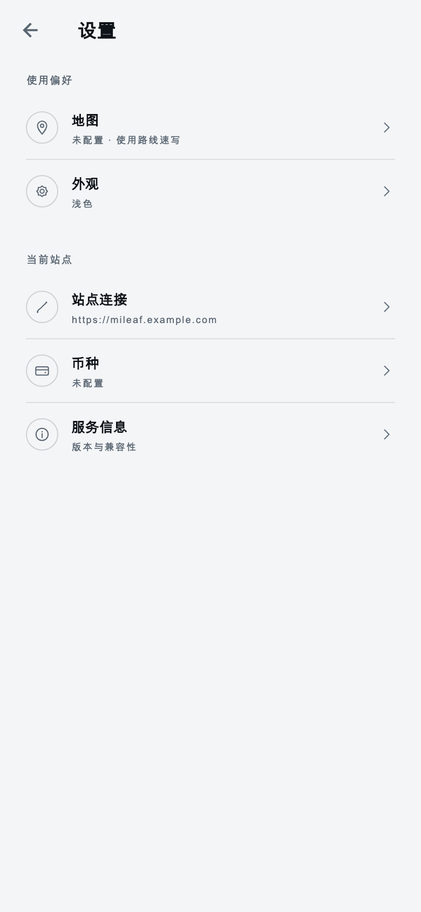
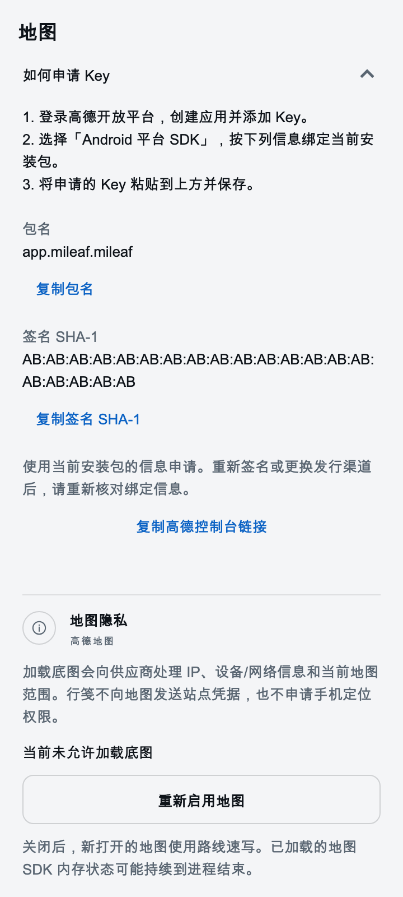

# 申请高德地图 Key

行笺通过你的高德地图 Key 加载底图。Android 和 iPhone 需要分别申请对应平台的 Key，填写后保存在当前设备。未配置时，行程仍可显示路线速写。

## 1. 先取到安装包的绑定信息

1. 点击 App 右上角的设置图标，进入「设置」。
2. 在「使用偏好」分组中点击「地图」。这一行下方会显示本机的地图配置状态。
3. 在地图页的「申请帮助」分组中展开「如何申请 Key」。

- Android 会显示「包名」与「签名 SHA-1」。分别点击这两行右侧的复制按钮。
- iPhone 会显示「Bundle ID」。点击该行右侧的复制按钮。

复制按钮是两个叠放方框的图标。大字号模式下，按钮会排在对应信息下方。点击后会显示已复制的提示。页面中的「高德控制台链接」也有复制按钮，复制后可粘贴到浏览器打开。

请使用页面当前显示的信息。不同签名、重新打包或其他发行渠道的 Android 安装包，签名 SHA-1 可能不同。当前官方工程的包名与 Bundle ID 为 `app.mileaf.mileaf`。

## 2. 在高德控制台创建应用

在浏览器打开高德开放平台控制台，登录并按控制台要求完成账户认证。进入应用管理，创建一个应用，可以命名为「行笺个人地图」。已有合适的应用时，也可以在其中添加 Key。[高德开放平台控制台](https://console.amap.com/dev/key/app)

## 3. 添加对应平台的 Key

### Android

1. 点击「添加 Key」，服务平台选择「Android 平台 SDK」。
2. 将行笺显示的包名填写到 Package 字段。
3. 将行笺显示的签名 SHA-1 填写到对应安全码字段。控制台区分调试与发布安全码时，按当前安装包的构建类型填写。当前仓库研发 release 仍使用开发签名。
4. 按控制台要求确认服务条款并提交。
5. 复制生成的 Key。

页面读取的是当前安装包的实际签名。自行更换签名后，需要同步更新控制台绑定信息。[Android 地图 SDK 官方申请说明](https://developer.amap.com/api/maps-sdk-for-android/guide/create-project/get-key)

### iPhone

1. 点击「添加 Key」，服务平台选择「iOS 平台 SDK」。
2. 将行笺显示的 Bundle ID 填入安全码字段。
3. 按控制台要求确认服务条款并提交。
4. 复制生成的 Key。

自行编译并修改 Bundle ID 后，需要按新安装包显示的值申请或调整绑定。[iOS 地图 SDK 官方申请说明](https://developer.amap.com/api/ios-sdk/guide/create-project/get-key)

## 4. 回到行笺填写

回到地图页顶部的「本机配置」，将 Key 粘贴到「Android 地图 Key」或「iOS 地图 Key」，点击「保存 Key」。已保存过 Key 时，先点击显示脱敏末四位的 Key 行，再填写新值。

保存后查看页面状态。显示「已保存 · 重新启动后生效」时，按提示结束 App 进程并重新打开。接着在「地图隐私」中检查「底图授权」，未允许时点击「重新启用地图」，阅读提示并选择「允许加载」。详细步骤见[地图设置教程](amap-key-settings.md)。

高德账户的可用额度和用量以控制台当前展示为准，可以在账户中查看。申请时选择的平台应与当前设备一致。

截图来自正式 Flutter 页面与合成配置，其中的站点地址、签名 SHA-1 和 Key 摘要为示例。申请时请复制自己设备页面中的绑定信息。
