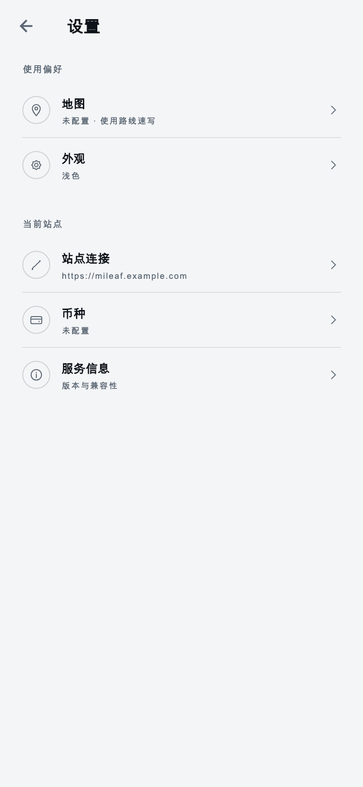
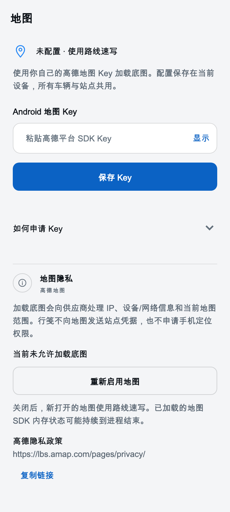
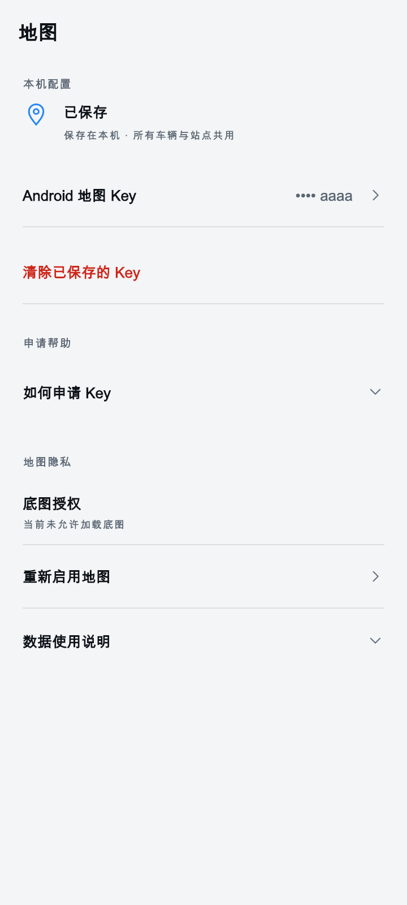
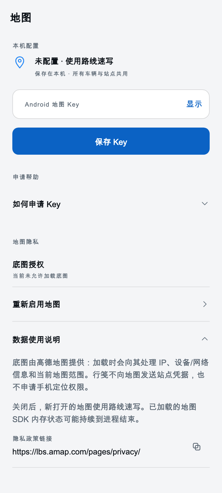

# 在行笺中设置地图 Key

地图 Key 保存在当前设备，该设备上的所有车辆与连接站点共用。切换车辆、站点或退出登录后仍会保留。

## 找到地图设置

点击 App 右上角的设置图标，在「使用偏好」分组中点击「地图」。地图行下方直接显示本机配置状态，例如「未配置 · 使用路线速写」或「已保存」。行程或充电详情的路线速写也提供「配置地图」入口，加载失败时可通过「地图设置」进入同一页面。

地图页自上而下分为三个分组。

| 分组 | 可以做什么 |
| --- | --- |
| 本机配置 | 查看配置状态，填写、更换或清除 Key |
| 申请帮助 | 展开「如何申请 Key」，查看申请步骤，复制安装包绑定信息与高德控制台链接 |
| 地图隐私 | 查看底图授权，启用或关闭底图，展开「数据使用说明」 |

「如何申请 Key」和「数据使用说明」默认折叠，点击标题行可展开，再次点击可收起。

## 首次设置

1. 进入「设置 → 使用偏好 → 地图」，找到顶部的「本机配置」。
2. 将申请的 Key 粘贴到「Android 地图 Key」或「iOS 地图 Key」输入框。输入默认遮挡，点击「显示」可检查内容，点击「隐藏」恢复遮挡。申请步骤见[高德 Key 申请教程](amap-key-application.md)。
3. 点击「保存 Key」。页面顶部显示「已保存」时，本机配置已完成，输入框收为一条带脱敏末四位和右箭头的 Key 行。
4. 向下找到「地图隐私」。如果「底图授权」显示「当前未允许加载底图」，点击「重新启用地图」，阅读弹出的说明并选择「允许加载」。已显示「当前已允许加载底图」时，可直接进入下一步。
5. 返回一条带坐标的行程或充电详情，查看底图加载结果。

首次配置且本次运行尚未初始化地图 SDK 时，保存的 Key 可直接用于下一次地图加载。页面中的「已保存」表示本机保存结果，底图是否加载成功请在详情地图查看。

## 更换 Key

点击「Android 地图 Key」（iPhone 为「iOS 地图 Key」）这一行右侧的箭头，填写新的 Key 并保存。输入时点击「取消更换」可返回原配置。

如果本次运行已经初始化地图 SDK，页面状态会显示「已保存 · 重新启动后生效」，并提示本次运行仍使用原 Key。请从系统最近任务中结束行笺进程，再重新打开。仅返回页面或切到后台仍会保留本次运行的原 Key。

## 清除 Key

点击红色的「清除已保存的 Key」行，在「清除地图 Key？」对话框中点击「清除 Key」。点击「取消」可保留配置。

清除成功后地图立即回到路线速写，页面重新显示 Key 输入框。若出现「已清除 · 重新启动可结束地图 SDK」，请按提示结束 App 进程后重新打开。

## 申请帮助

展开「如何申请 Key」，会看到三条申请步骤，以及当前安装包的绑定信息。Android 显示包名和签名 SHA-1，iPhone 显示 Bundle ID。点击对应行的叠放方框图标即可复制，大字号模式下按钮位于信息下方。复制成功时页面会显示提示。

下方的「高德控制台链接」行显示 `console.amap.com/dev/key/app`，复制得到完整的 HTTPS 链接，可粘贴到浏览器打开。完整申请步骤见[高德 Key 申请教程](amap-key-application.md)。

## 地图隐私与数据使用说明

「地图隐私」分组先用「底图授权」一行给出当前状态，再提供对应操作。

| 当前状态 | 操作 |
| --- | --- |
| 当前未允许加载底图 | 点击「重新启用地图」，阅读说明后选择「允许加载」；选择「暂不」可保留当前状态 |
| 当前已允许加载底图 | 点击「关闭底图」，之后新打开的地图使用路线速写 |

关闭底图后，已保存的 Key 仍会保留。再次使用时，通过「重新启用地图」重新授权。已加载的地图 SDK 内存状态可能持续到进程结束。

需要了解地图会处理哪些信息时，展开「数据使用说明」，其中说明供应商处理的 IP、设备与网络信息、关闭底图后的效果，并提供可复制的隐私政策链接。

## 常见情况

| 页面情况 | 处理方式 |
| --- | --- |
| 提示 Key 格式错误 | 复制完整的 32 位 Key，检查中间是否夹有空格；首尾空白会自动去除 |
| 保存或清除失败 | 保留页面输入，检查设备存储状态后重试，原配置仍保留 |
| 地图配置读取失败 | 点击「重试读取配置」，恢复前地图使用路线速写 |
| 安装包绑定信息读取失败 | 展开「如何申请 Key」后点击「重试读取绑定信息」 |
| 复制失败 | 重试复制，或长按对应信息手动选择并复制 |
| 地图加载失败 | 检查网络、高德控制台的 Key 平台、包名／签名或 Bundle ID 绑定，以及 Key 账户状态；详情地图可重试，也可进入地图设置 |
| 显示已保存，但底图未启用 | 查看「地图隐私」段的「底图授权」状态，按需点击「重新启用地图」并阅读同意提示 |
| 提示没有有效轨迹坐标 | 当前记录缺少地图所需坐标，可查看其他带坐标的记录 |

本教程截图来自正式 Flutter 组件与合成配置，绑定信息、Key 摘要均为示例。
