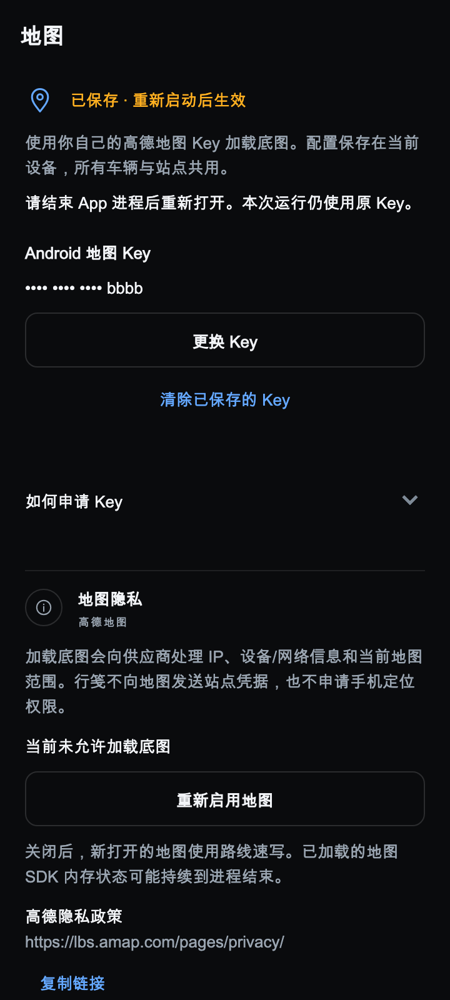
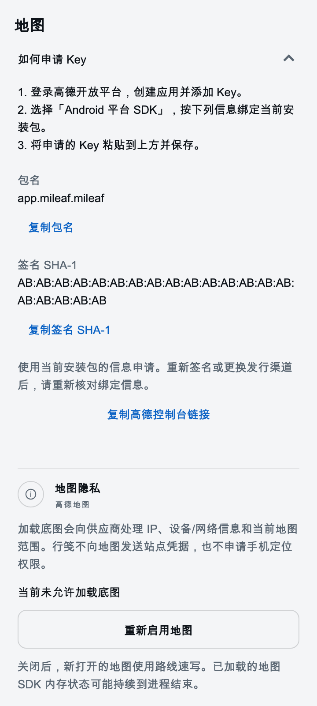

# 在行笺中设置地图 Key

地图 Key 保存在当前设备，该设备上的所有车辆与连接站点共用。切换车辆、站点或退出登录后仍会保留。

## 首次设置

1. 点击概览右上角设置，进入「服务版本与兼容性 → 地图」。也可以从行程或充电详情的路线速写中点击「配置地图」。
2. 粘贴对应平台的高德 Key。输入默认遮挡，点击「显示」可检查内容。
3. 点击「保存 Key」。页面显示「已保存」时，本机配置已完成。
4. 在地图页下方查看隐私说明。允许加载底图后，再打开一条带坐标的行程或充电详情。

首次配置且本次运行尚未初始化地图 SDK 时，保存的 Key 可直接用于下一次地图加载。页面中的「已保存」表示本机保存结果，底图是否加载成功请在详情地图查看。

## 更换 Key

点击「更换 Key」，填写新的 Key 并保存。输入时点击「取消更换」可返回原配置。

如果本次运行已经初始化地图 SDK，页面会显示「已保存 · 重新启动后生效」。请从系统最近任务中结束行笺进程，再重新打开。仅返回页面或切到后台仍会保留本次运行的原 Key。

## 清除 Key

点击「清除已保存的 Key」，在对话框中确认。成功后地图立即回到路线速写。已经加载的地图 SDK 可能保留进程内存，按提示重新启动 App 可结束这部分状态。

## 申请帮助

展开「如何申请 Key」，可以复制当前安装包的包名、签名 SHA-1 或 Bundle ID，也可以复制高德控制台链接，在浏览器中打开。完整申请步骤见[高德 Key 申请教程](amap-key-application.md)。

## 常见情况

| 页面情况 | 处理方式 |
| --- | --- |
| 提示 Key 格式错误 | 复制完整的 32 位 Key，检查中间是否夹有空格；首尾空白会自动去除 |
| 保存或清除失败 | 保留页面输入，检查设备存储状态后重试，原配置仍保留 |
| 地图配置读取失败 | 点击「重试读取配置」，恢复前地图使用路线速写 |
| 安装包绑定信息读取失败 | 展开帮助后点击「重试读取绑定信息」 |
| 地图加载失败 | 检查网络、高德控制台的 Key 平台、包名／签名或 Bundle ID 绑定，以及 Key 账户状态；详情地图可重试，也可进入地图设置 |
| 显示已保存，但底图未启用 | 查看下方地图隐私授权状态，按需点击「重新启用地图」并阅读同意提示 |
| 提示没有有效轨迹坐标 | 当前记录缺少地图所需坐标，可查看其他带坐标的记录 |

本教程截图来自正式 Flutter 组件与合成配置，绑定信息、Key 摘要均为示例。
